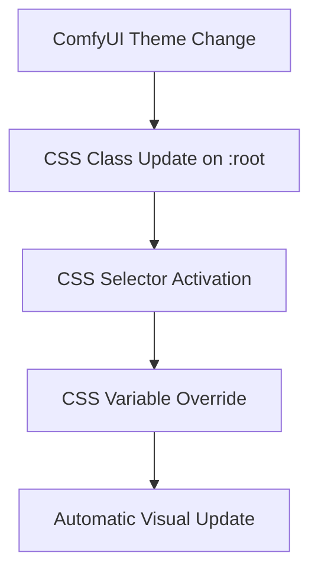
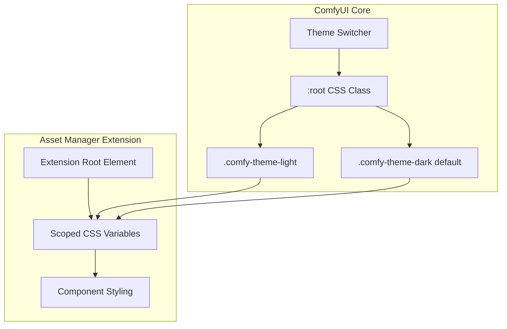
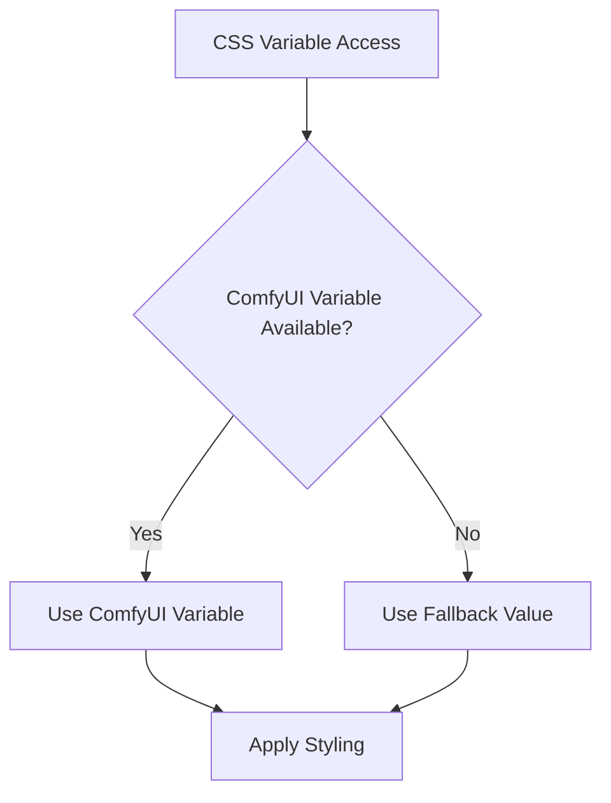

# Design Document

## Overview

The ComfyUI Theme Integration feature provides automatic theme adaptation for the Asset Manager extension using ComfyUI's existing CSS-based theme system. The design follows the proven pattern from ComfyUI's React Extension Template, using CSS selectors and custom properties to automatically adapt to light and dark themes without complex JavaScript theme management.

## Architecture

### CSS-Based Theme System

The theme integration uses ComfyUI's existing CSS class-based theme switching mechanism:



### Simple Integration Pattern



## Components and Interfaces

### CSS Theme Structure

#### Extension Root Styling
```css
/* Default (dark) theme variables */
:root {
  --asset-manager-bg-primary: var(--comfy-menu-bg, #2a2a2a);
  --asset-manager-bg-secondary: var(--comfy-input-bg, #3a3a3a);
  --asset-manager-text-primary: var(--input-text, #ffffff);
  --asset-manager-text-secondary: var(--descrip-text, #cccccc);
  --asset-manager-border-primary: var(--border-color, #555555);
  --asset-manager-interactive-primary: var(--p-button-text-primary-color, #007acc);
}

/* Light theme overrides */
:root.comfy-theme-light #asset-manager-root {
  --asset-manager-bg-primary: var(--comfy-menu-bg, #f0f0f0);
  --asset-manager-bg-secondary: var(--comfy-input-bg, #ffffff);
  --asset-manager-text-primary: var(--input-text, #000000);
  --asset-manager-text-secondary: var(--descrip-text, #666666);
  --asset-manager-border-primary: var(--border-color, #cccccc);
  --asset-manager-interactive-primary: var(--p-button-text-primary-color, #0066cc);
}
```

#### Component Styling Pattern
```css
.asset-card {
  background-color: var(--asset-manager-bg-secondary);
  color: var(--asset-manager-text-primary);
  border: 1px solid var(--asset-manager-border-primary);
  transition: background-color 0.2s ease, border-color 0.2s ease;
}

.asset-card:hover {
  background-color: var(--comfy-input-bg-hover, var(--asset-manager-bg-primary));
  border-color: var(--comfy-input-border-hover, var(--asset-manager-interactive-primary));
}
```

### Optional React Hook for Theme Detection

#### Simple Theme Hook (Optional)
```typescript
interface UseThemeReturn {
  isLight: boolean;
  isDark: boolean;
}

const useComfyUITheme = (): UseThemeReturn => {
  const [isLight, setIsLight] = useState(false);
  
  useEffect(() => {
    const checkTheme = () => {
      setIsLight(document.documentElement.classList.contains('comfy-theme-light'));
    };
    
    checkTheme();
    
    // Optional: Listen for theme changes
    const observer = new MutationObserver(checkTheme);
    observer.observe(document.documentElement, {
      attributes: true,
      attributeFilter: ['class']
    });
    
    return () => observer.disconnect();
  }, []);
  
  return {
    isLight,
    isDark: !isLight
  };
};
```

### Notification Integration

#### ComfyUI Toast Integration
```typescript
interface ComfyUINotificationService {
  showToast: (message: string, type: 'info' | 'success' | 'error' | 'warning') => void;
  isToastAvailable: () => boolean;
}

// Simple integration with ComfyUI's toast system
const useComfyUINotifications = (): ComfyUINotificationService => {
  return {
    showToast: (message: string, type: string) => {
      // Check if ComfyUI's toast API is available
      if (window.app?.extensionManager?.toast) {
        window.app.extensionManager.toast(message, { type });
      } else {
        // Fallback to console or custom notification
        console.log(`[${type.toUpperCase()}] ${message}`);
      }
    },
    isToastAvailable: () => {
      return !!(window.app?.extensionManager?.toast);
    }
  };
};
```

### CSS-First Component Approach

#### Themed Components Using CSS Classes
```typescript
interface ThemedComponentProps {
  variant?: 'primary' | 'secondary' | 'accent';
  size?: 'small' | 'medium' | 'large';
  className?: string;
}

// Example themed button component using CSS classes
const ThemedButton: React.FC<ThemedComponentProps & ButtonHTMLAttributes<HTMLButtonElement>> = ({
  variant = 'primary',
  size = 'medium',
  className = '',
  children,
  ...props
}) => {
  const classes = `asset-manager-button asset-manager-button--${variant} asset-manager-button--${size} ${className}`;
  
  return (
    <button className={classes} {...props}>
      {children}
    </button>
  );
};
```

#### CSS Implementation for Themed Components
```css
.asset-manager-button {
  background-color: var(--asset-manager-bg-secondary);
  color: var(--asset-manager-text-primary);
  border: 1px solid var(--asset-manager-border-primary);
  border-radius: 4px;
  padding: 8px 16px;
  cursor: pointer;
  transition: all 0.2s ease;
}

.asset-manager-button--primary {
  background-color: var(--asset-manager-interactive-primary);
  color: white;
}

.asset-manager-button:hover {
  background-color: var(--comfy-input-bg-hover, var(--asset-manager-bg-primary));
  border-color: var(--comfy-input-border-hover, var(--asset-manager-interactive-primary));
}
```

## Data Models

### Simple Theme State (Optional)
```typescript
interface ThemeState {
  isLight: boolean;
  isDark: boolean;
}

// No complex state management needed - CSS handles everything
```

### CSS Variable Structure
```typescript
interface AssetManagerThemeVariables {
  // Background colors
  '--asset-manager-bg-primary': string;
  '--asset-manager-bg-secondary': string;
  
  // Text colors
  '--asset-manager-text-primary': string;
  '--asset-manager-text-secondary': string;
  
  // Border colors
  '--asset-manager-border-primary': string;
  
  // Interactive colors
  '--asset-manager-interactive-primary': string;
}
```

## Error Handling

### CSS Fallback Strategy


### Simple Error Recovery
1. **CSS Variable Fallbacks**: All CSS variables include fallback values
   ```css
   background-color: var(--comfy-menu-bg, #2a2a2a);
   ```

2. **Default Theme**: Extension defaults to dark theme if no theme class detected

3. **Graceful Degradation**: Extension remains functional even if ComfyUI theme system changes

### No Complex Error Boundaries Needed
Since the theme system is CSS-based, there are minimal JavaScript errors to handle. The browser's CSS engine handles fallbacks automatically.

## Testing Strategy

### CSS Testing
- **Theme Switching**: Test CSS selectors activate correctly with theme class changes
- **Variable Fallbacks**: Test CSS variables fall back to default values when ComfyUI variables unavailable
- **Component Styling**: Test all components render correctly in both light and dark themes

### Integration Testing
- **ComfyUI Integration**: Test theme switching in actual ComfyUI environment
- **Cross-Browser Testing**: Test CSS variable support across browsers
- **Notification Integration**: Test toast notification integration when available

### Visual Regression Testing
- **Theme Consistency**: Compare screenshots across theme switches
- **Component Styling**: Verify all components match ComfyUI's visual patterns

### Simple Testing Utilities
```typescript
interface ThemeTestUtils {
  setComfyUITheme: (theme: 'light' | 'dark') => void;
  getCSSVariableValue: (name: string) => string;
}

// Test utility implementation
const themeTestUtils: ThemeTestUtils = {
  setComfyUITheme: (theme: 'light' | 'dark') => {
    if (theme === 'light') {
      document.documentElement.classList.add('comfy-theme-light');
    } else {
      document.documentElement.classList.remove('comfy-theme-light');
    }
  },
  
  getCSSVariableValue: (name: string) => {
    return getComputedStyle(document.documentElement).getPropertyValue(name);
  }
};
```

## Implementation Approach

### Single Phase: CSS-First Implementation
1. **CSS Theme Variables**: Define extension-specific CSS variables that reference ComfyUI variables
2. **Theme Selectors**: Implement CSS selectors for light/dark theme overrides
3. **Component Updates**: Update existing components to use CSS variables instead of hardcoded colors
4. **Optional Hook**: Create simple theme detection hook for components that need JavaScript theme awareness

### Development Guidelines

#### CSS Variable Pattern
```css
/* Define extension variables that reference ComfyUI variables */
:root {
  --asset-manager-bg-primary: var(--comfy-menu-bg, #2a2a2a);
  --asset-manager-text-primary: var(--input-text, #ffffff);
}

/* Override for light theme */
:root.comfy-theme-light #asset-manager-root {
  --asset-manager-bg-primary: var(--comfy-menu-bg, #f0f0f0);
  --asset-manager-text-primary: var(--input-text, #000000);
}

/* Use in components */
.asset-card {
  background-color: var(--asset-manager-bg-primary);
  color: var(--asset-manager-text-primary);
}
```

#### Component Theming Pattern
```typescript
// Prefer CSS classes over inline styles
const ThemedComponent: React.FC<Props> = ({ className = '', ...props }) => {
  return (
    <div className={`asset-manager-component ${className}`} {...props}>
      {/* Content */}
    </div>
  );
};
```

#### Performance Benefits
- **No JavaScript Re-renders**: Theme changes handled entirely by CSS
- **Browser Optimized**: CSS transitions and variables are browser-optimized
- **Minimal Bundle Size**: No complex theme management libraries needed
- **Instant Theme Switching**: No JavaScript processing delay

## Integration Points

### ComfyUI Extension System
- **No Special Registration**: Theme system works automatically through CSS
- **Extension Root Element**: Use scoped root element ID for theme isolation
- **Toast Integration**: Optional integration with ComfyUI's toast notification system

### Asset Manager Integration
- **CSS Migration**: Update existing CSS files to use CSS variables
- **Component Updates**: Replace hardcoded colors with CSS variable references
- **Root Element**: Ensure all components are wrapped in themed root element

### Simplicity Benefits
- **Zero Configuration**: Works out of the box with ComfyUI's theme system
- **Automatic Updates**: Inherits any future ComfyUI theme improvements
- **Minimal Maintenance**: CSS-based approach requires minimal ongoing maintenance
- **Extension Compatibility**: Other extensions can easily adopt the same pattern