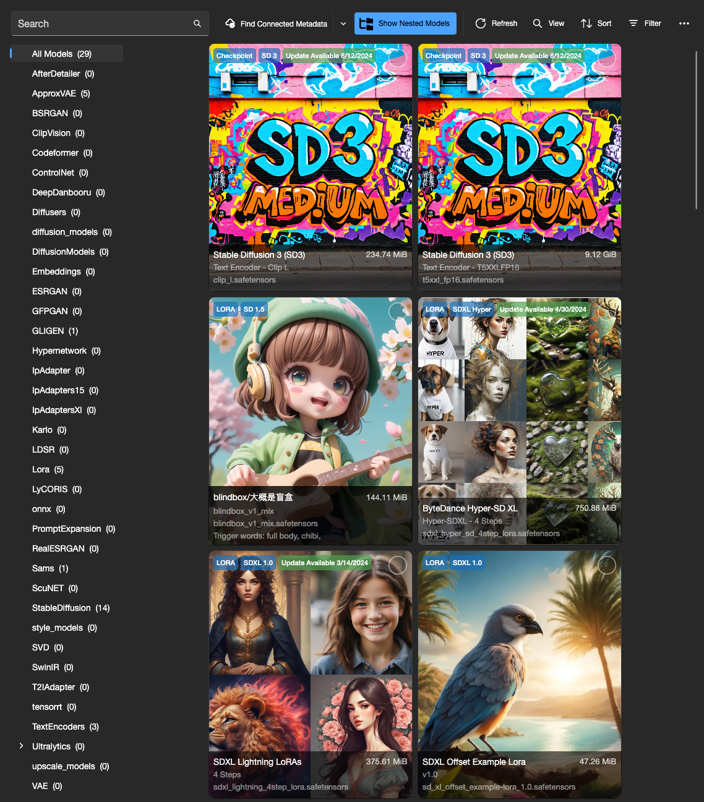
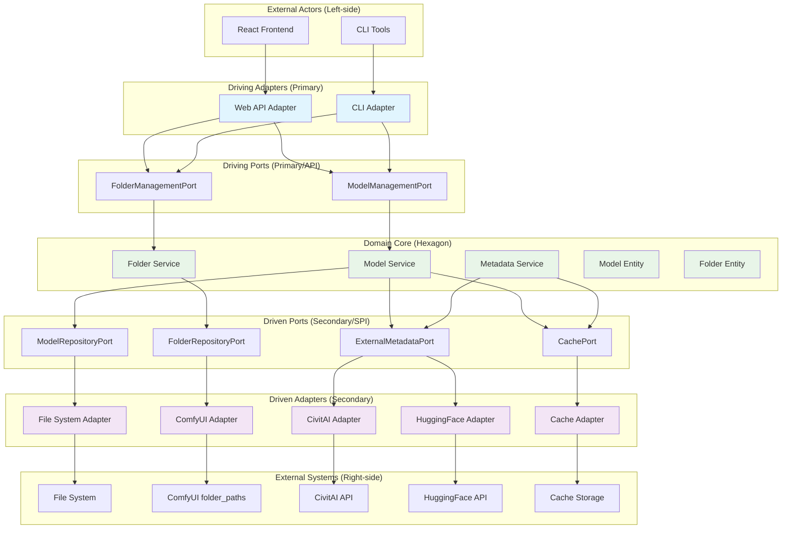

# Design Document

## Overview

The Local Asset Management feature provides a comprehensive interface for browsing, organizing, and managing locally stored AI models within ComfyUI. The design follows a client-server architecture where the Python backend integrates with ComfyUI's folder system and external APIs, while the React frontend provides an intuitive user interface within ComfyUI's sidebar.

The system leverages ComfyUI's existing `folder_paths` module to discover model locations and integrates with external platforms (CivitAI, HuggingFace) to enrich model metadata. The system also respects ComfyUI's `extra_model_paths.yaml` configuration file for custom model paths. All enhanced metadata is cached locally for performance optimization.

### UI Reference Design

The interface design is inspired by Stability Matrix's checkpoint manager, as shown in the reference image:



Key design elements from the reference:

- **Left sidebar navigation**: Folder tree structure for different model types
- **Main grid view**: Card-based layout showing model thumbnails and basic information
- **Search and filter bar**: Top-level search with filtering options
- **Model cards**: Display thumbnail, name, file size, and quick action buttons
- **Detailed information**: Rich metadata display with external platform integration

## Architecture

### High-Level Architecture (Hexagonal/Ports and Adapters)



### Component Interaction Flow

1. **Model Discovery**: Backend scans ComfyUI folders using `folder_paths`
2. **Metadata Enrichment**: External APIs provide additional model information
3. **Caching**: Enhanced metadata stored locally for performance
4. **UI Rendering**: Frontend displays organized model collections
5. **User Interactions**: Drag-and-drop, search, filtering, and organization

## Components and Interfaces

### Backend Components (Hexagonal Architecture)

#### Domain Layer (Core Business Logic)

##### 1. Model Service (implements ModelManagementPort)

**Purpose**: Core business logic for model management

```python
class ModelService(ModelManagementPort):
    def __init__(self, model_repository: ModelRepositoryPort,
                 metadata_service: MetadataService):
        self._model_repository = model_repository
        self._metadata_service = metadata_service

    def get_models_in_folder(self, folder_id: str) -> List[Model]:
        # Implementation using driven ports
        pass

    def get_model_details(self, model_id: str) -> Model:
        # Implementation using driven ports
        pass

    def search_models(self, query: str, folder_id: Optional[str]) -> List[Model]:
        # Implementation using driven ports
        pass

    def enrich_model_metadata(self, model: Model) -> Model:
        # Implementation using driven ports
        pass
```

##### 2. Folder Service (implements FolderManagementPort)

**Purpose**: Manages folder structure and organization

```python
class FolderService(FolderManagementPort):
    def __init__(self, folder_repository: FolderRepositoryPort):
        self._folder_repository = folder_repository

    def get_all_folders(self) -> List[Folder]:
        # Implementation using driven ports
        pass

    def get_folder_by_id(self, folder_id: str) -> Folder:
        # Implementation using driven ports
        pass

    def get_folder_structure(self) -> Dict[str, Folder]:
        # Implementation using driven ports
        pass
```

##### 3. Metadata Service

**Purpose**: Handles external metadata enrichment and user metadata management

```python
class MetadataService:
    def __init__(self, civitai_port: ExternalMetadataPort,
                 huggingface_port: ExternalMetadataPort,
                 cache_port: CachePort,
                 user_metadata_port: UserMetadataPort):
        self._civitai_port = civitai_port
        self._huggingface_port = huggingface_port
        self._cache_port = cache_port
        self._user_metadata_port = user_metadata_port

    def enrich_metadata(self, model: Model) -> ExternalMetadata
    def get_cached_metadata(self, model_hash: str) -> Optional[ExternalMetadata]
    def save_user_metadata(self, model_id: str, metadata: UserMetadata) -> bool
    def get_user_metadata(self, model_id: str) -> Optional[UserMetadata]
    def bulk_update_metadata(self, updates: List[MetadataUpdate]) -> BulkUpdateResult
```

##### 4. Usage Tracking Service

**Purpose**: Tracks asset usage in workflows and provides usage analytics

```python
class UsageTrackingService:
    def __init__(self, usage_repository: UsageRepositoryPort):
        self._usage_repository = usage_repository

    def track_asset_usage(self, asset_id: str, workflow_id: str) -> None
    def get_currently_used_assets(self, workflow_id: str) -> List[str]
    def get_recent_assets(self, limit: int = 10) -> List[Model]
    def get_usage_statistics(self, asset_id: str) -> UsageStatistics
```

#### Ports (Interfaces)

##### Driving Ports (Primary/Left-side - API for the domain)

These ports define what the application can do and are implemented by the domain services.

```python
from abc import ABC, abstractmethod

class ModelManagementPort(ABC):
    """Primary port for model management operations"""
    @abstractmethod
    def get_models_in_folder(self, folder_id: str) -> List[Model]:
        pass

    @abstractmethod
    def get_model_details(self, model_id: str) -> Model:
        pass

    @abstractmethod
    def search_models(self, query: str, folder_id: Optional[str]) -> List[Model]:
        pass

    @abstractmethod
    def enrich_model_metadata(self, model: Model) -> Model:
        pass

    @abstractmethod
    def update_user_metadata(self, model_id: str, metadata: UserMetadata) -> bool:
        pass

    @abstractmethod
    def bulk_update_metadata(self, updates: List[MetadataUpdate]) -> BulkUpdateResult:
        pass

    @abstractmethod
    def get_currently_used_models(self, workflow_id: str) -> List[Model]:
        pass

    @abstractmethod
    def track_model_usage(self, model_id: str, workflow_id: str) -> None:
        pass

class FolderManagementPort(ABC):
    """Primary port for folder management operations"""
    @abstractmethod
    def get_all_folders(self) -> List[Folder]:
        pass

    @abstractmethod
    def get_folder_by_id(self, folder_id: str) -> Folder:
        pass

    @abstractmethod
    def get_folder_structure(self) -> Dict[str, Folder]:
        pass
```

##### Driven Ports (Secondary/Right-side - SPI for infrastructure)

These ports define what the application needs and are implemented by the adapters.

```python
class ModelRepositoryPort(ABC):
    """Secondary port for model data access"""
    @abstractmethod
    def find_all_in_folder(self, folder_id: str) -> List[Model]:
        pass

    @abstractmethod
    def find_by_id(self, model_id: str) -> Optional[Model]:
        pass

    @abstractmethod
    def search(self, query: str, folder_id: Optional[str]) -> List[Model]:
        pass

class FolderRepositoryPort(ABC):
    """Secondary port for folder data access"""
    @abstractmethod
    def get_all_folders(self) -> List[Folder]:
        pass

    @abstractmethod
    def get_folder_structure(self) -> Dict[str, Folder]:
        pass

class ExternalMetadataPort(ABC):
    """Secondary port for external metadata services"""
    @abstractmethod
    def fetch_metadata(self, identifier: str) -> Optional[ExternalMetadata]:
        pass

class CachePort(ABC):
    """Secondary port for caching services"""
    @abstractmethod
    def get(self, key: str) -> Optional[Any]:
        pass

    @abstractmethod
    def set(self, key: str, value: Any, ttl: Optional[int] = None):
        pass

class UserMetadataPort(ABC):
    """Secondary port for user metadata persistence"""
    @abstractmethod
    def save_metadata(self, model_id: str, metadata: UserMetadata) -> bool:
        pass

    @abstractmethod
    def get_metadata(self, model_id: str) -> Optional[UserMetadata]:
        pass

    @abstractmethod
    def bulk_update_metadata(self, updates: List[MetadataUpdate]) -> BulkUpdateResult:
        pass

class UsageRepositoryPort(ABC):
    """Secondary port for usage tracking"""
    @abstractmethod
    def record_usage(self, asset_id: str, workflow_id: str, timestamp: datetime) -> None:
        pass

    @abstractmethod
    def get_current_usage(self, workflow_id: str) -> List[str]:
        pass

    @abstractmethod
    def get_recent_usage(self, limit: int) -> List[UsageRecord]:
        pass

    @abstractmethod
    def get_usage_statistics(self, asset_id: str) -> UsageStatistics:
        pass
```

#### Adapters (Infrastructure)

##### 1. ComfyUI Folder Adapter

```python
class ComfyUIFolderAdapter(FolderRepositoryPort):
    def __init__(self):
        import folder_paths
        self._folder_paths = folder_paths

    def get_all_folders(self) -> List[Folder]:
        """Get all model folders from ComfyUI's folder_paths system."""
        folders = []
        # Standard ComfyUI model folders
        folder_types = [
            'checkpoints', 'loras', 'vae', 'embeddings',
            'controlnet', 'upscale_models', 'hypernetworks',
            'clip', 'unet', 'diffusers'
        ]

        for folder_type in folder_types:
            try:
                paths = self._folder_paths.get_folder_paths(folder_type)
                if paths:
                    folders.append(Folder(
                        id=folder_type,
                        name=folder_type.title(),
                        path=paths[0],  # Primary path
                        model_type=ModelType(folder_type)
                    ))
            except Exception:
                # Handle cases where folder type doesn't exist
                continue

        return folders
```

##### 2. File System Model Adapter

```python
class FileSystemModelAdapter(ModelRepositoryPort):
    def __init__(self, comfyui_adapter: ComfyUIFolderAdapter):
        self._comfyui_adapter = comfyui_adapter
        # Use ComfyUI's supported file extensions
        import folder_paths
        self._supported_extensions = folder_paths.supported_pt_extensions

    def find_all_in_folder(self, folder_id: str) -> List[Model]:
        """Scan folder for models using ComfyUI's supported file extensions."""
        folder = self._comfyui_adapter.get_folder_by_id(folder_id)
        models = []

        for ext in self._supported_extensions:
            pattern = os.path.join(folder.path, f"*.{ext}")
            for file_path in glob.glob(pattern):
                model = self._create_model_from_file(file_path, folder_id)
                models.append(model)

        return models
```

##### 3. CivitAI Metadata Adapter

```python
class CivitAIMetadataAdapter(ExternalMetadataPort):
    def __init__(self, api_client: HTTPClient):
        self._api_client = api_client

    def fetch_metadata(self, model_hash: str) -> Optional[ExternalMetadata]:
        # Implementation calling CivitAI API
        pass
```

##### 5. User Metadata Adapter

```python
class UserMetadataAdapter(UserMetadataPort):
    def __init__(self, metadata_file_path: str):
        self._metadata_file_path = metadata_file_path

    def save_metadata(self, model_id: str, metadata: UserMetadata) -> bool:
        """Save user metadata to local JSON file."""
        try:
            # Load existing metadata
            existing_data = self._load_metadata_file()
            existing_data[model_id] = metadata.to_dict()
            
            # Save updated metadata
            self._save_metadata_file(existing_data)
            return True
        except Exception:
            return False

    def bulk_update_metadata(self, updates: List[MetadataUpdate]) -> BulkUpdateResult:
        """Perform bulk metadata updates with error handling."""
        successful = []
        failed = []
        
        for update in updates:
            try:
                if self.save_metadata(update.modelId, update.metadata):
                    successful.append(update.modelId)
                else:
                    failed.append({"modelId": update.modelId, "error": "Save failed"})
            except Exception as e:
                failed.append({"modelId": update.modelId, "error": str(e)})
        
        return BulkUpdateResult(
            successful=successful,
            failed=failed,
            totalProcessed=len(updates)
        )
```

##### 6. Usage Tracking Adapter

```python
class UsageTrackingAdapter(UsageRepositoryPort):
    def __init__(self, usage_db_path: str):
        self._usage_db_path = usage_db_path

    def record_usage(self, asset_id: str, workflow_id: str, timestamp: datetime) -> None:
        """Record asset usage in local database."""
        # Implementation using SQLite or JSON file
        pass

    def get_current_usage(self, workflow_id: str) -> List[str]:
        """Get assets currently used in a specific workflow."""
        # Query current workflow state
        pass

    def get_usage_statistics(self, asset_id: str) -> UsageStatistics:
        """Get comprehensive usage statistics for an asset."""
        # Calculate usage metrics from stored data
        pass
```

##### 7. Web API Adapter (Driving Adapter)

```python
class WebAPIAdapter:
    """Driving adapter that translates HTTP requests to domain operations"""
    def __init__(self, model_management: ModelManagementPort,
                 folder_management: FolderManagementPort):
        self._model_management = model_management
        self._folder_management = folder_management

    # HTTP endpoint handlers that use driving ports
    async def get_folders(self, request):
        folders = self._folder_management.get_all_folders()
        return web.json_response([folder.to_dict() for folder in folders])

    async def get_models_in_folder(self, request):
        folder_id = request.match_info['folder_id']
        models = self._model_management.get_models_in_folder(folder_id)
        return web.json_response([model.to_dict() for model in models])

    async def update_model_metadata(self, request):
        model_id = request.match_info['model_id']
        metadata_data = await request.json()
        metadata = UserMetadata.from_dict(metadata_data)
        
        success = self._model_management.update_user_metadata(model_id, metadata)
        return web.json_response({"success": success})

    async def bulk_update_metadata(self, request):
        updates_data = await request.json()
        updates = [MetadataUpdate.from_dict(update) for update in updates_data]
        
        result = self._model_management.bulk_update_metadata(updates)
        return web.json_response(result.to_dict())

    async def search_models(self, request):
        query = request.query.get('q', '')
        folder_id = request.query.get('folder_id')
        
        models = self._model_management.search_models(query, folder_id)
        return web.json_response([model.to_dict() for model in models])

    async def track_usage(self, request):
        data = await request.json()
        model_id = data['model_id']
        workflow_id = data['workflow_id']
        
        self._model_management.track_model_usage(model_id, workflow_id)
        return web.json_response({"success": True})
```

#### SOLID Principles Application

1. **Single Responsibility**: Each service has one clear responsibility
2. **Open/Closed**: New adapters can be added without modifying core services
3. **Liskov Substitution**: All adapters implement their respective ports correctly
4. **Interface Segregation**: Ports are focused and specific to their use cases
5. **Dependency Inversion**: Core services depend on abstractions (ports), not concrete implementations

### Frontend Components

#### 1. Folder Navigation Component

**Purpose**: Displays ComfyUI folder structure and handles navigation

**Props Interface**:

```typescript
interface FolderNavigationProps {
  folders: ModelFolder[];
  selectedFolder: string;
  onFolderSelect: (folderId: string) => void;
}
```

#### 2. Model Grid Component

**Purpose**: Displays models in a responsive grid layout with loading states and empty state handling

**Props Interface**:

```typescript
interface ModelGridProps {
  models: ModelInfo[];
  loading: boolean;
  onModelSelect: (model: ModelInfo) => void;
  onModelDrag: (model: ModelInfo) => void;
  emptyStateMessage?: string;
  emptyStateGuidance?: string;
}
```

**Design Rationale**: The component must handle three distinct states - loading, populated, and empty. Empty states should provide helpful guidance to users about why no assets are shown and what actions they can take.

**Empty State Implementation**:

```typescript
const EmptyState = ({ message, guidance }: { message: string; guidance: string }) => (
  <div className="empty-state">
    <div className="empty-state-icon">📁</div>
    <h3 className="empty-state-message">{message}</h3>
    <p className="empty-state-guidance">{guidance}</p>
  </div>
);
```

#### 3. Model Detail Modal

**Purpose**: Shows comprehensive model information and metadata with copy functionality

**Props Interface**:

```typescript
interface ModelDetailModalProps {
  model: EnrichedModelInfo;
  isOpen: boolean;
  onClose: () => void;
  onAddToWorkflow: (model: ModelInfo) => void;
  onCopyFilePath: (filePath: string) => void;
}
```

**Design Rationale**: Users need quick access to file paths for external tools or manual workflow creation. The copy functionality should provide immediate feedback when the path is copied to clipboard.

**Copy Functionality Implementation**:

```typescript
const CopyButton = ({ text, label }: { text: string; label: string }) => {
  const [copied, setCopied] = useState(false);
  
  const handleCopy = async () => {
    try {
      await navigator.clipboard.writeText(text);
      setCopied(true);
      setTimeout(() => setCopied(false), 2000);
    } catch (error) {
      console.error('Failed to copy to clipboard:', error);
    }
  };
  
  return (
    <button onClick={handleCopy} className="copy-button">
      {copied ? '✓ Copied!' : `📋 Copy ${label}`}
    </button>
  );
};
```

#### 4. Search and Filter Bar

**Purpose**: Provides search and filtering capabilities with real-time filtering and result highlighting

**Design Rationale**: Search results must highlight matching terms to help users quickly identify why specific assets matched their query. This improves search efficiency and user understanding.

**Search Highlighting Implementation**:

```typescript
const highlightSearchTerms = (text: string, searchQuery: string): string => {
  if (!searchQuery.trim()) return text;
  
  const regex = new RegExp(`(${searchQuery.replace(/[.*+?^${}()|[\]\\]/g, '\\$&')})`, 'gi');
  return text.replace(regex, '<mark class="search-highlight">$1</mark>');
};

const SearchResultCard = ({ result }: { result: SearchResult }) => (
  <div className="search-result-card">
    <h3 dangerouslySetInnerHTML={{ __html: result.highlightedName }} />
    {result.highlightedDescription && (
      <p dangerouslySetInnerHTML={{ __html: result.highlightedDescription }} />
    )}
    <div className="matched-fields">
      Matched in: {result.matchedFields.join(', ')}
    </div>
  </div>
);
```

**Props Interface**:

```typescript
interface SearchFilterBarProps {
  searchQuery: string;
  onSearchChange: (query: string) => void;
  filters: FilterOptions;
  onFilterChange: (filters: FilterOptions) => void;
  onClearSearch: () => void;
  searchResults?: SearchResult[];
  isSearching?: boolean;
}

interface FilterOptions {
  modelTypes: ModelType[];
  fileSizeRange: [number, number];
  dateRange: [Date, Date];
  tags: string[];
  hasExternalMetadata: boolean;
}

interface SearchResult {
  model: ModelInfo;
  matchedFields: string[];
  highlightedName: string;
  highlightedDescription?: string;
  matchScore: number;
}

interface SearchHighlighting {
  highlightClassName: string;
  maxHighlights: number;
  contextLength: number;
}
```

#### 5. Bulk Operations Component

**Purpose**: Handles multi-asset selection and bulk operations

**Props Interface**:

```typescript
interface BulkOperationsProps {
  selectedAssets: ModelInfo[];
  onBulkTag: (assets: ModelInfo[], tags: string[]) => Promise<BulkOperationResult>;
  onBulkMove: (assets: ModelInfo[], targetFolder: string) => Promise<BulkOperationResult>;
  onBulkDelete: (assets: ModelInfo[]) => Promise<BulkOperationResult>;
  onClearSelection: () => void;
}

interface BulkOperationResult {
  successful: ModelInfo[];
  failed: Array<{ asset: ModelInfo; error: string }>;
  summary: string;
}
```

#### 6. Asset Usage Tracker Component

**Purpose**: Tracks and displays asset usage in workflows

**Props Interface**:

```typescript
interface AssetUsageTrackerProps {
  currentWorkflowAssets: string[];
  recentAssets: ModelInfo[];
  onHighlightUsedAssets: (assetIds: string[]) => void;
}
```

## Thumbnail and Placeholder Design

### Thumbnail Management

**Design Rationale**: Assets without thumbnails should display meaningful placeholder images that help users identify the asset type at a glance. This improves visual scanning and user experience.

**Placeholder Implementation**:

```typescript
const getThumbnailSrc = (model: ModelInfo): string => {
  if (model.thumbnail) {
    return model.thumbnail;
  }
  
  // Return type-specific placeholder
  const placeholders: Record<ModelType, string> = {
    [ModelType.CHECKPOINT]: '/assets/placeholders/checkpoint.svg',
    [ModelType.LORA]: '/assets/placeholders/lora.svg',
    [ModelType.VAE]: '/assets/placeholders/vae.svg',
    [ModelType.EMBEDDING]: '/assets/placeholders/embedding.svg',
    [ModelType.CONTROLNET]: '/assets/placeholders/controlnet.svg',
    [ModelType.UPSCALER]: '/assets/placeholders/upscaler.svg',
    [ModelType.HYPERNETWORK]: '/assets/placeholders/hypernetwork.svg',
    [ModelType.CLIP]: '/assets/placeholders/clip.svg',
    [ModelType.UNET]: '/assets/placeholders/unet.svg',
  };
  
  return placeholders[model.modelType] || '/assets/placeholders/default.svg';
};

const ModelThumbnail = ({ model }: { model: ModelInfo }) => {
  const [imageError, setImageError] = useState(false);
  
  return (
    <div className="model-thumbnail">
       setImageError(true)}
        className="thumbnail-image"
      />
      <div className="model-type-badge">{model.modelType}</div>
    </div>
  );
};
```

## Data Models

### Core Data Structures

```typescript
interface ModelInfo {
  id: string;
  name: string;
  filePath: string;
  fileSize: number;
  createdAt: Date;
  modifiedAt: Date;
  modelType: ModelType;
  hash: string;
  thumbnail?: string;
  folder: string;
  isCurrentlyUsed?: boolean;
  lastUsedAt?: Date;
  usageCount?: number;
  compatibilityInfo?: CompatibilityInfo;
  associatedDocumentation?: string[];
}

interface ThumbnailConfig {
  defaultPlaceholders: Record<ModelType, string>;
  fallbackIcon: string;
  thumbnailSize: { width: number; height: number };
}

interface EnrichedModelInfo extends ModelInfo {
  externalMetadata?: {
    civitai?: CivitAIMetadata;
    huggingface?: HuggingFaceMetadata;
  };
  userMetadata?: {
    tags: string[];
    description: string;
    rating: number;
    customNotes?: string;
  };
}

interface CompatibilityInfo {
  comfyuiVersion: string;
  requiredNodes?: string[];
  conflicts?: string[];
  recommendations?: string[];
}

interface ModelFolder {
  id: string;
  name: string;
  path: string;
  modelType: ModelType;
  modelCount: number;
}

enum ModelType {
  CHECKPOINT = "checkpoint",
  LORA = "lora",
  VAE = "vae",
  EMBEDDING = "embedding",
  CONTROLNET = "controlnet",
  UPSCALER = "upscaler",
  HYPERNETWORK = "hypernetwork", // Added based on ComfyUI documentation
  CLIP = "clip", // Added for CLIP models
  UNET = "unet", // Added for standalone diffusion models
}
```

### External API Data Structures

```typescript
interface CivitAIMetadata {
  modelId: number;
  name: string;
  description: string;
  tags: string[];
  images: string[];
  downloadCount: number;
  rating: number;
  creator: string;
}

interface HuggingFaceMetadata {
  modelId: string;
  description: string;
  tags: string[];
  downloads: number;
  likes: number;
  library: string;
}

interface UserMetadata {
  tags: string[];
  description: string;
  rating: number;
  customNotes?: string;
  lastModified: Date;
}

interface MetadataUpdate {
  modelId: string;
  metadata: UserMetadata;
}

interface BulkUpdateResult {
  successful: string[];
  failed: Array<{ modelId: string; error: string }>;
  totalProcessed: number;
}

interface UsageRecord {
  assetId: string;
  workflowId: string;
  timestamp: Date;
  assetName: string;
}

interface UsageStatistics {
  totalUsage: number;
  lastUsed: Date;
  averageUsagePerWeek: number;
  popularWorkflows: string[];
}
```

## Error Handling

### Backend Error Handling

1. **File System Errors**:

   - Handle missing folders gracefully
   - Provide fallback when `folder_paths` is unavailable
   - Log errors without breaking the service

2. **External API Errors**:

   - Implement exponential backoff for rate limiting
   - Cache negative results to avoid repeated failed requests
   - Gracefully degrade when external services are unavailable

3. **Data Validation**:
   - Validate model file formats and integrity using ComfyUI's supported extensions
   - Handle corrupted metadata files
   - Sanitize user input for security
   - Validate file paths are within ComfyUI's model directories

4. **Metadata Editing Error Handling**:
   - Preserve original metadata when edits fail
   - Provide specific error messages for validation failures
   - Implement optimistic updates with rollback capability
   - Show clear feedback when metadata persistence fails

### Frontend Error Handling

1. **Network Errors**:

   - Display user-friendly error messages
   - Implement retry mechanisms for failed requests
   - Show offline indicators when backend is unavailable

2. **Loading State Management**:
   - Provide immediate feedback for all user actions
   - Use skeleton loaders for content that's loading
   - Show progress indicators for long-running operations
   - Implement graceful loading state transitions

**Loading Indicator Implementation**:

```typescript
interface LoadingState {
  isLoading: boolean;
  loadingMessage?: string;
  progress?: number;
}

const LoadingSpinner = ({ message, progress }: { message?: string; progress?: number }) => (
  <div className="loading-container">
    <div className="loading-spinner" />
    {message && <p className="loading-message">{message}</p>}
    {progress !== undefined && (
      <div className="loading-progress">
        <div className="progress-bar">
          <div className="progress-fill" style={{ width: `${progress}%` }} />
        </div>
        <span className="progress-text">{Math.round(progress)}%</span>
      </div>
    )}
  </div>
);

const SkeletonCard = () => (
  <div className="skeleton-card">
    <div className="skeleton-thumbnail" />
    <div className="skeleton-title" />
    <div className="skeleton-metadata" />
  </div>
);
```

2. **UI State Errors**:
   - Handle empty states gracefully with helpful guidance messages
   - Provide loading indicators for long operations
   - Implement error boundaries for component failures

3. **Search and Filter Error Handling**:
   - Display "no results found" messages with search suggestions
   - Handle search timeout scenarios gracefully
   - Provide clear feedback when filters produce no results

**Search Empty State Implementation**:

```typescript
const SearchEmptyState = ({ 
  searchQuery, 
  activeFilters, 
  onClearSearch, 
  onClearFilters 
}: {
  searchQuery: string;
  activeFilters: FilterOptions;
  onClearSearch: () => void;
  onClearFilters: () => void;
}) => {
  const hasActiveFilters = Object.values(activeFilters).some(filter => 
    Array.isArray(filter) ? filter.length > 0 : filter !== null
  );

  return (
    <div className="search-empty-state">
      <div className="empty-state-icon">🔍</div>
      <h3>No assets found</h3>
      {searchQuery && (
        <p>No assets match "{searchQuery}"</p>
      )}
      {hasActiveFilters && (
        <p>Try adjusting your filters or search terms</p>
      )}
      <div className="empty-state-actions">
        {searchQuery && (
          <button onClick={onClearSearch} className="clear-search-btn">
            Clear search
          </button>
        )}
        {hasActiveFilters && (
          <button onClick={onClearFilters} className="clear-filters-btn">
            Clear filters
          </button>
        )}
      </div>
      <div className="search-suggestions">
        <h4>Search suggestions:</h4>
        <ul>
          <li>Try different keywords</li>
          <li>Check your spelling</li>
          <li>Use broader search terms</li>
          <li>Remove some filters</li>
        </ul>
      </div>
    </div>
  );
};
```

4. **Bulk Operation Error Handling**:
   - Show progress indicators for long-running bulk operations
   - Provide detailed error reports for failed operations
   - Allow partial success scenarios with clear feedback

5. **Drag-and-Drop Error Handling**:
   - Provide clear feedback when drag-and-drop operations fail
   - Show compatibility warnings before attempting to add assets to workflows
   - Handle scenarios where ComfyUI workflow integration is unavailable

**Drag-and-Drop Error Implementation**:

```typescript
interface DragDropResult {
  success: boolean;
  error?: string;
  compatibilityIssues?: string[];
}

const useDragDropFeedback = () => {
  const [dragState, setDragState] = useState<{
    isDragging: boolean;
    dragError?: string;
    showCompatibilityWarning?: boolean;
  }>({ isDragging: false });

  const handleDragStart = (model: ModelInfo) => {
    // Check compatibility before drag
    const compatibility = checkComfyUICompatibility(model);
    if (!compatibility.isCompatible) {
      setDragState({
        isDragging: false,
        showCompatibilityWarning: true,
        dragError: `Incompatible: ${compatibility.issues.join(', ')}`
      });
      return false;
    }
    
    setDragState({ isDragging: true });
    return true;
  };

  const handleDragEnd = (result: DragDropResult) => {
    if (!result.success) {
      setDragState({
        isDragging: false,
        dragError: result.error || 'Failed to add asset to workflow'
      });
      
      // Show error toast
      showNotification(result.error || 'Drag and drop failed', 'error');
    } else {
      setDragState({ isDragging: false });
      showNotification('Asset added to workflow successfully', 'success');
    }
  };

  return { dragState, handleDragStart, handleDragEnd };
};
```

6. **Metadata Management Error Handling**:
   - Preserve original metadata when edits fail
   - Show validation errors for invalid metadata inputs
   - Handle external metadata fetch failures gracefully
   - Implement optimistic UI updates with error recovery

**Metadata Error Handling Implementation**:

```typescript
interface MetadataEditState {
  original: UserMetadata;
  current: UserMetadata;
  isEditing: boolean;
  isSaving: boolean;
  error?: string;
}

const useMetadataEditor = (modelId: string, initialMetadata: UserMetadata) => {
  const [state, setState] = useState<MetadataEditState>({
    original: initialMetadata,
    current: initialMetadata,
    isEditing: false,
    isSaving: false,
  });

  const saveMetadata = async (metadata: UserMetadata) => {
    setState(prev => ({ ...prev, isSaving: true, error: undefined }));
    
    try {
      await apiClient.updateModelMetadata(modelId, metadata);
      setState(prev => ({ 
        ...prev, 
        original: metadata, 
        current: metadata, 
        isEditing: false, 
        isSaving: false 
      }));
    } catch (error) {
      setState(prev => ({ 
        ...prev, 
        current: prev.original, // Rollback to original
        error: error.message,
        isSaving: false 
      }));
    }
  };

  const cancelEdit = () => {
    setState(prev => ({ 
      ...prev, 
      current: prev.original, 
      isEditing: false, 
      error: undefined 
    }));
  };

  return { state, saveMetadata, cancelEdit };
};
```

## ComfyUI Workflow Integration

### Drag-and-Drop Implementation

The system provides seamless integration with ComfyUI workflows through drag-and-drop functionality and direct workflow manipulation.

#### Design Rationale

**Decision**: Implement drag-and-drop using HTML5 Drag and Drop API with ComfyUI's graph manipulation system.

**Rationale**: This approach provides the most intuitive user experience while leveraging ComfyUI's existing node system. Users can directly drag models from the asset manager onto the ComfyUI canvas, automatically creating appropriate loader nodes.

#### Implementation Strategy

```typescript
// Drag-and-drop data transfer format
interface AssetDragData {
  type: 'comfyui-asset';
  assetId: string;
  assetPath: string;
  modelType: ModelType;
  compatibleNodes: string[];
}

// ComfyUI integration service
class ComfyUIIntegrationService {
  addAssetToWorkflow(asset: ModelInfo, position?: [number, number]): Promise<boolean> {
    // Determine compatible node type based on asset type
    const nodeType = this.getCompatibleNodeType(asset.modelType);
    
    // Create node using ComfyUI's graph API
    const node = app.graph.createNode(nodeType);
    
    // Set asset path in appropriate widget
    this.setAssetPath(node, asset.filePath);
    
    // Position and add to graph
    if (position) node.pos = position;
    app.graph.add(node);
    
    // Track usage
    this.trackAssetUsage(asset.id);
    
    return true;
  }
}
```

### Usage Tracking and Highlighting

#### Design Rationale

**Decision**: Implement real-time usage tracking that highlights currently used assets and maintains usage history.

**Rationale**: This provides valuable feedback to users about which assets are actively being used in their workflows, helping them understand dependencies and make informed decisions about asset management.

#### Implementation Approach

- Monitor ComfyUI workflow changes to detect asset usage
- Maintain a real-time list of assets currently in use
- Provide visual indicators in the asset grid for used assets
- Track usage statistics for analytics and recommendations

### Quick Actions and Context Menu

#### Design Rationale

**Decision**: Provide context-sensitive quick actions based on asset type and current workflow state.

**Rationale**: Different asset types require different integration approaches. Checkpoints need different loader nodes than LoRAs, and the system should intelligently suggest the most appropriate actions.

#### Quick Action Categories

1. **Load Actions**: Add to workflow with appropriate loader node
2. **Replace Actions**: Replace currently selected asset in workflow
3. **Compare Actions**: Load alongside current asset for comparison
4. **Workflow Actions**: Create new workflow with this asset as base

## Testing Strategy

### Backend Testing

1. **Unit Tests**:

   - Test model scanning logic with mock file systems
   - Test metadata enrichment with mocked API responses
   - Test caching mechanisms and data persistence

2. **Integration Tests**:

   - Test ComfyUI `folder_paths` integration
   - Test external API integration with real endpoints
   - Test end-to-end model discovery and enrichment

3. **Performance Tests**:
   - Test scanning performance with large model collections
   - Test API response times under load
   - Test memory usage during metadata caching

### Frontend Testing

1. **Component Tests**:

   - Test individual component rendering and interactions
   - Test drag-and-drop functionality
   - Test search and filtering logic

2. **Integration Tests**:

   - Test API client integration
   - Test state management and data flow
   - Test ComfyUI integration points

3. **E2E Tests**:
   - Test complete user workflows
   - Test error scenarios and recovery
   - Test performance with large datasets

### Test Data Strategy

- Create mock model collections for consistent testing
- Use test fixtures for external API responses
- Implement database seeding for integration tests
- Create performance benchmarks for regression testing

## Bulk Operations Design

### Multi-Selection Interface

#### Design Rationale

**Decision**: Implement checkbox-based multi-selection with keyboard shortcuts for efficient bulk operations.

**Rationale**: Large model collections require efficient bulk management capabilities. Users need to be able to select multiple assets quickly and perform operations like tagging, moving, or organizing without repetitive individual actions.

#### Selection Mechanisms

1. **Checkbox Selection**: Individual checkboxes on each asset card
2. **Shift-Click Range Selection**: Select ranges of assets
3. **Ctrl-Click Toggle Selection**: Add/remove individual assets from selection
4. **Select All/None**: Quick selection controls
5. **Filter-Based Selection**: Select all assets matching current filters

### Bulk Operation Types

#### Metadata Operations

- **Bulk Tagging**: Add or remove tags from multiple assets
- **Bulk Rating**: Apply ratings to multiple assets
- **Bulk Description**: Add common descriptions or notes

#### Organizational Operations

- **Bulk Move**: Move assets between folders (where supported)
- **Bulk Archive**: Mark assets as archived or inactive
- **Bulk Favorite**: Add assets to favorites collection

#### Progress and Error Handling

```typescript
interface BulkOperationProgress {
  total: number;
  completed: number;
  failed: number;
  currentItem?: string;
  errors: Array<{ item: string; error: string }>;
}

// Progress tracking component
const BulkOperationProgress = ({ operation }: { operation: BulkOperationProgress }) => {
  const progressPercentage = (operation.completed / operation.total) * 100;
  
  return (
    <div className="bulk-operation-progress">
      <div className="progress-bar">
        <div className="progress-fill" style={{ width: `${progressPercentage}%` }} />
      </div>
      <div className="progress-text">
        {operation.completed} of {operation.total} completed
        {operation.failed > 0 && ` (${operation.failed} failed)`}
      </div>
    </div>
  );
};
```

## Search and Filtering Design

### Advanced Search Capabilities

#### Design Rationale

**Decision**: Implement real-time search with multiple search modes and result highlighting.

**Rationale**: Users need to quickly locate specific assets from potentially large collections. The search system should be fast, intuitive, and provide immediate feedback with highlighted results.

#### Search Implementation

```typescript
interface SearchConfiguration {
  searchFields: Array<'name' | 'tags' | 'description' | 'metadata'>;
  searchMode: 'contains' | 'startsWith' | 'fuzzy' | 'regex';
  caseSensitive: boolean;
  highlightMatches: boolean;
}

class SearchService {
  performSearch(query: string, assets: ModelInfo[], config: SearchConfiguration): SearchResult[] {
    // Implement fuzzy search with ranking
    // Highlight matching terms in results
    // Return ranked results with match information
  }
}
```

### Filter Categories

#### File-Based Filters

- **Model Type**: Checkpoint, LoRA, VAE, Embedding, etc.
- **File Size**: Size ranges with slider interface
- **Date Range**: Creation/modification date filters
- **File Format**: .safetensors, .ckpt, .pt, etc.

#### Metadata-Based Filters

- **Tags**: User-defined and external platform tags
- **Rating**: User ratings and external platform ratings
- **Usage**: Recently used, frequently used, never used
- **External Metadata**: Has CivitAI data, has HuggingFace data

#### Advanced Filter Combinations

- **Filter Groups**: Combine multiple filters with AND/OR logic
- **Saved Filters**: Save common filter combinations
- **Quick Filters**: One-click access to common filter sets

## Documentation and Readme Integration

### Associated Documentation Discovery

#### Design Rationale

**Decision**: Automatically discover and display documentation files associated with models.

**Rationale**: Many models come with readme files, documentation, or usage instructions. The system should automatically detect these files and make them easily accessible to users, improving the overall user experience and model understanding.

#### Documentation Detection Strategy

```python
class DocumentationService:
    def find_associated_documentation(self, model_path: str) -> List[str]:
        """Find documentation files associated with a model."""
        model_dir = os.path.dirname(model_path)
        model_name = os.path.splitext(os.path.basename(model_path))[0]
        
        # Common documentation file patterns
        patterns = [
            f"{model_name}.md",
            f"{model_name}.txt",
            f"{model_name}_readme.md",
            "README.md",
            "readme.txt",
            "info.txt",
            "description.md"
        ]
        
        found_docs = []
        for pattern in patterns:
            doc_path = os.path.join(model_dir, pattern)
            if os.path.exists(doc_path):
                found_docs.append(doc_path)
        
        return found_docs
```

### Documentation Display

#### Integration in Model Detail Modal

- **Tabbed Interface**: Separate tab for documentation content
- **Markdown Rendering**: Support for markdown-formatted documentation
- **Text Formatting**: Basic formatting for plain text files
- **File Links**: Links to open documentation files externally

#### Documentation Preview

- **Inline Preview**: Show first few lines of documentation in model cards
- **Documentation Indicator**: Visual indicator when documentation is available
- **Quick Access**: Hover or click to preview documentation content
