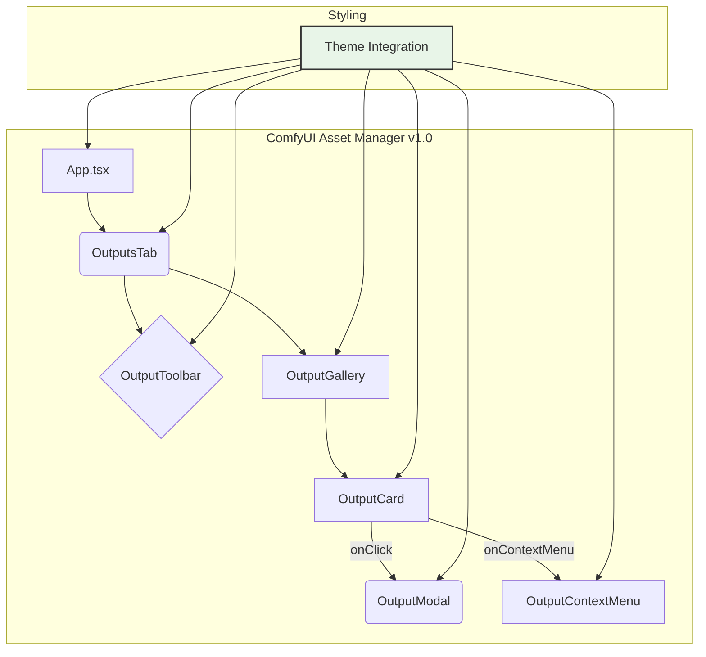

# ComfyUI Asset Manager v1.0 Enhancement Architecture

## Introduction

This document outlines the architectural approach for releasing **version 1.0 of the ComfyUI Asset Manager**. Its primary goal is to serve as the guiding architectural blueprint for AI-driven development, ensuring a high-quality, focused initial release.

### Document Scope

This architecture document defines the scope for the v1.0 release. The strategy is to **hide incomplete features** ("Local Asset Management" and "Model Browser") and focus all effort on completing and polishing the **"Output Gallery"** and its core dependency, the **"ComfyUI Theme Integration"**.

### Change Log

| Date       | Version | Description                                                                                             | Author    |
|------------|---------|---------------------------------------------------------------------------------------------------------|-----------|
| 2025-09-20 | 1.1     | Refocused architecture for v1.0 release. Scope narrowed to Output Gallery and Theme Integration.        | Architect |
| 2025-09-07 | 1.0     | Initial brownfield analysis of the entire project state.                                                | Architect |

## Enhancement Scope and Integration Strategy

### Enhancement Overview
- **Enhancement Type:** v1.0 Release Scoping & Feature Completion
- **Scope:** Hide the incomplete "Local Assets" and "Model Browser" tabs. Complete and polish the "Output Gallery" and "Theme Integration" features for a stable, public release.
- **Integration Impact:** Low. This change primarily involves UI modifications to hide feature tabs and completing the implementation of existing, well-defined services for the output gallery.

### Integration Approach
- **Code Integration Strategy:** The `LocalAssetsTab` and `ModelBrowserTab` components will be conditionally rendered out of the main application view, likely in `ui/src/App.tsx`. This can be done via commenting out the code or using a feature flag. No backend API endpoints for these features will be exposed or documented for v1.0.
- **UI Integration:** The primary focus is ensuring the `OutputsTab` and all its child components are fully functional, visually polished, and correctly inherit styles from the `comfyui-theme-integration` work. All visible UI elements must be themed correctly for both light and dark modes.

## Component Architecture for v1.0

### Modified Components
- **`ui/src/App.tsx`**: Will be modified to conditionally render only the `OutputsTab`, effectively hiding the other two features.
- **`ui/src/features/outputs/**`**: All components within the output gallery feature require final implementation touches as per their task list (`.kiro/specs/simplified-output-gallery/tasks.md`), specifically:
    - **Performance:** Virtual scrolling must be implemented in the `OutputGallery` component to handle large numbers of images gracefully.
    - **Error Handling:** Robust `ErrorBoundary` components and user-friendly error states (e.g., for directory access errors, broken images) must be finalized.
- **All Visible Components**: Must be refactored to use the new CSS variables from the theme integration, removing any hardcoded color values.

### v1.0 Component Interaction Diagram


## Source Tree Integration

For v1.0, no new files are expected. The work is confined to modifying existing files:
- **`ui/src/App.tsx`**: To hide the feature tabs.
- **`ui/src/features/outputs/**/*.tsx`**: To implement performance optimizations and finalize UI polish.
- **`ui/src/features/outputs/**/*.css`**: To apply theme variables.
- **`tests-e2e/**`**: New E2E tests will be added for the Output Gallery.

## Testing Strategy for v1.0

### New Testing Requirements
- **Unit & Integration Tests**:
  - The remaining tasks for the `OutputService` and `FilesystemOutputAdapter` must be completed, and full test coverage must be achieved.
- **End-to-End (E2E) Tests**:
  - A comprehensive Playwright test suite must be created for the **Output Gallery**. This suite must cover the entire user flow: viewing the gallery, sorting, filtering, opening the modal, using all context menu actions, and loading a workflow.
- **Visual Regression Tests**:
  - This is **critical** for the Theme Integration. A new test suite will be added, likely using Playwright's screenshot capabilities, to capture images of the Output Gallery in both light and dark themes. These tests will fail if any visual changes occur, ensuring theme consistency is maintained.

## Next Steps

### Story Manager Handoff
The following user stories should be prioritized for the development team to achieve the v1.0 release:
1.  **Spike: Hide Incomplete Features**: As a developer, I need to modify the main App component to hide the "Local Assets" and "Model Browser" tabs so that users only see the "Output Gallery".
2.  **Feat: Implement Virtual Scrolling**: As a user with thousands of images, I want the Output Gallery to scroll smoothly without freezing the UI, so that I can efficiently browse my entire collection.
3.  **Feat: Harden Error Handling**: As a user, if the output directory is missing or an image is corrupt, I want to see a clear, helpful error message instead of a broken UI, so that I understand the problem.
4.  **Test: E2E and Visual Regression**: As a QA engineer, I need a full suite of E2E and visual regression tests for the Output Gallery and Theme Integration, so that we can release v1.0 with high confidence.

### Developer Handoff
Developers should focus on the following:
- **File to Modify First**: `ui/src/App.tsx` to hide the tabs.
- **Primary Task List**: `.kiro/specs/simplified-output-gallery/tasks.md`. Specifically focus on completing tasks #7 (Performance optimizations) and #8 (Integration testing).
- **Testing Command**: A new script should be added to `ui/package.json` called `test:visual` to run the visual regression tests.

---

# Appendix - Existing System Analysis

*This section contains the original brownfield analysis, which serves as the foundation for the v1.0 enhancement plan.*

## Quick Reference - Key Files and Entry Points

### Critical Files for Understanding the System

- **Main Entry (Backend)**: `src/main.py` - Initializes the application and registers it with ComfyUI.
- **Main Entry (Frontend)**: `ui/src/main.tsx` - Registers the sidebar tab with ComfyUI's frontend.
- **Configuration**: `pyproject.toml` (backend), `ui/package.json` (frontend), `src/config.py`
- **Core Business Logic**: `src/domain/services/`
- **API Definitions**: `src/adapters/driving/web_api_adapter.py`
- **Data Models (Entities)**: `src/domain/entities/`
- **React Components**: `ui/src/features/`

## High Level Architecture

### Technical Summary

The ComfyUI Asset Manager is a hybrid Python/React extension for ComfyUI. It follows a hexagonal (ports and adapters) architecture to separate business logic from infrastructure concerns. The backend, written in Python using `aiohttp`, integrates with ComfyUI's server. The frontend is a modern React application using TypeScript and Vite.

### Actual Tech Stack

| Category      | Technology         | Version/Details                               | Notes                                     |
|---------------|--------------------|-----------------------------------------------|-------------------------------------------|
| **Backend**   |                    |                                               |                                           |
| Runtime       | Python             | >=3.12                                        |                                           |
| Framework     | aiohttp            | ^3.12.14                                      |                                           |
| Image Lib     | Pillow             | ^11.0.0                                       |                                           |
| Testing       | pytest             | ^8.2                                          |                                           |
| **Frontend**  |                    |                                               |                                           |
| Framework     | React              | ^18.2.0                                       |                                           |
| Language      | TypeScript         | ~5.8.3                                        |                                           |
| Build Tool    | Vite               | ^7.0.3                                        |                                           |
| State Mgt     | React Context/Hooks|                                               |                                           |
| i18n          | i18next            | ^23.10.2                                      |                                           |
| Testing       | Vitest, Playwright | ^3.2.4, ^1.47.2                               |                                           |
| **DevOps**    |                    |                                               |                                           |
| Package Mgt   | Poetry (Python)    |                                               |                                           |
|               | pnpm (JS)          |                                               |                                           |
| CI/CD         | GitHub Actions     | `python-ci.yml`, `react-ci.yml`, `react-build.yml` |                                           |

### Repository Structure Reality Check

- **Type**: Monorepo
- **Package Manager**: Poetry (Python), pnpm (JS)
- **Notable**: The project is well-structured, with clear separation between the `src` (backend) and `ui` (frontend) directories. The `.kiro/steering` and `docs/development` directories contain extensive documentation.

## Source Tree and Module Organization

### Project Structure (Actual)

```text
comfyui-asset-manager/
├── src/
│   ├── adapters/
│   │   ├── driven/
│   │   └── driving/
│   ├── domain/
│   │   ├── entities/
│   │   ├── services/
│   │   └── ports/
│   ├── utils/
│   ├── config.py
│   ├── container.py
│   └── main.py
├── ui/
│   ├── src/
│   │   ├── features/
│   │   │   ├── local-assets/
│   │   │   ├── model-browser/
│   │   │   └── outputs/
│   │   ├── components/
│   │   ├── hooks/
│   │   ├── services/
│   │   └── main.tsx
│   └── package.json
├── tests/
└── docs/
```

### Key Modules and Their Purpose

- **`src/domain`**: The core of the application, containing the business logic, entities, and ports. It is completely independent of any framework or infrastructure.
- **`src/adapters`**: Contains the implementation of the ports defined in the domain. `driving` adapters handle input to the application (e.g., web requests), while `driven` adapters handle output (e.g., file system access).
- **`ui/src/features`**: Contains the React components for each of the main features of the asset manager: local assets, model browser, and outputs.

## Data Models and APIs

### Data Models

The core data models (entities) are defined in `src/domain/entities/`. These include:
- `Model`
- `Folder`
- `Output`
- `ExternalModel`

These are dataclasses that represent the core concepts of the application.

### API Specifications

The API is defined in `src/adapters/driving/web_api_adapter.py`. All API endpoints are prefixed with `/asset_manager/`. Key endpoints include:

- `GET /asset_manager/outputs`
- `GET /asset_manager/outputs/{id}`
- `POST /asset_manager/outputs/refresh`
- `GET /asset_manager/external/models`
- `GET /asset_manager/external/models/{platform}/{model_id}`

## Technical Debt and Known Issues

- The `tasks.md` files for the various features indicate that some implementation is still pending, particularly around performance optimizations (virtual scrolling), and completing all error handling and empty states.
- The `TODO.md` file mentions a small enhancement to add a version to the "about" page badges.
- The `current-implementation-status.md` file indicates that while the domain core is 100% complete and tested, the adapters and the final dependency injection wiring are not yet fully implemented.

## Integration Points and External Dependencies

### External Services

| Service      | Purpose           | Integration Type | Key Files                               |
|--------------|-------------------|------------------|-----------------------------------------|
| CivitAI      | Model Discovery   | REST API         | `src/adapters/driven/civitai_api_adapter.py` |
| HuggingFace  | Model Discovery   | REST API         | `src/adapters/driven/huggingface_api_adapter.py` |

### Internal Integration Points

- **ComfyUI Backend**: The application integrates with ComfyUI's backend via the `__init__.py` file, registering web routes and the web directory. It uses ComfyUI's `folder_paths` module for model discovery.
- **ComfyUI Frontend**: The React application integrates with the ComfyUI frontend by registering a sidebar tab using `window.app.extensionManager.registerSidebarTab()`. It also uses ComfyUI's CSS variables for theming.

## Development and Deployment

### Local Development Setup

1.  Run `./setup.sh` to install all dependencies.
2.  Run `./dev_server.sh` to create a symlink to the ComfyUI `custom_nodes` directory and start the frontend in watch mode.

### Build and Deployment Process

- **Build Command**: `cd ui && pnpm run build`
- **Deployment**: The `dist/` directory is served by the Python backend. The extension is designed to be published to the ComfyUI Registry.

## Testing Reality

### Current Test Coverage

- **Unit Tests**: 64 unit tests for the domain services with 96-100% coverage.
- **Integration Tests**: Some integration tests exist, but more are needed for the adapters.
- **E2E Tests**: Playwright is set up for end-to-end testing, but the extent of test coverage is not specified in the provided documents.

### Running Tests

```bash
# Backend tests
poetry run pytest

# Frontend tests
cd ui && pnpm run test
```

## Appendix - Useful Commands and Scripts

### Frequently Used Commands

```bash
# Install all dependencies
./setup.sh

# Start development server
./dev_server.sh

# Run all backend tests
poetry run pytest

# Run all frontend tests
cd ui && pnpm run test
```

---

# Appendix - Kiro Documentation

This section contains the preserved content from the `.kiro` directory.

## From .kiro/steering/ts-conventions.md

---
inclusion: fileMatch
fileMatchPattern: ["**/*.tsx", "**/*.ts", "ui/src/**/*"]
---

# TypeScript/JavaScript Conventions

## Naming Conventions

- **Variables & Functions**: Use camelCase (`getUserData`, `isLoading`)
- **Classes & Components**: Use PascalCase (`ModelCard`, `AssetManager`)
- **Constants**: Use UPPER_SNAKE_CASE (`API_BASE_URL`, `MAX_FILE_SIZE`)
- **Files**: Use kebab-case for files (`model-card.tsx`, `asset-service.ts`)
- **Directories**: Use kebab-case (`local-assets`, `model-browser`)

## File Organization

### Component Structure

```
components/
├── ModelCard/
│   ├── ModelCard.tsx        # Main component
│   ├── ModelCard.css        # Component styles
│   ├── ModelCard.test.tsx   # Component tests
│   └── index.ts             # Clean exports
```

### Feature Structure

```
features/
├── local-assets/
│   ├── LocalAssetsTab.tsx   # Main feature component
│   ├── components/          # Feature-specific components
│   ├── services/           # Feature-specific services
│   ├── types.ts            # Feature-specific types
│   └── index.ts            # Feature exports
```

## TypeScript Best Practices

### Type Definitions

```typescript
// Prefer interfaces for object shapes
interface ModelCardProps {
  model: Model;
  onSelect: (model: Model) => void;
  isSelected?: boolean;
}

// Use types for unions and computed types
type ModelType = 'checkpoint' | 'lora' | 'vae' | 'embedding';
type ModelStatus = 'loading' | 'ready' | 'error';

// Use enums for fixed sets of values
enum SortOrder {
  ASC = 'asc',
  DESC = 'desc'
}
```

### Function Signatures

```typescript
// Explicit return types for exported functions
export const fetchModels = async (folderId: string): Promise<Model[]> => {
  // Implementation
};

// Use generic types for reusable functions
export const createApiClient = <T>(baseUrl: string): ApiClient<T> => {
  // Implementation
};
```

### Error Handling

```typescript
// Use discriminated unions for error states
type ApiResult<T> = 
  | { success: true; data: T }
  | { success: false; error: string };

// Type-safe error handling
const handleApiResult = <T>(result: ApiResult<T>): T => {
  if (result.success) {
    return result.data;
  }
  throw new Error(result.error);
};
```

### React Component Patterns

```typescript
// Functional components with explicit props interface
interface ComponentProps {
  title: string;
  onAction: (action: string) => void;
  children?: React.ReactNode;
}

const MyComponent = ({ title, onAction, children }: ComponentProps) => {
  return (
    <div>
      <h1>{title}</h1>
      {children}
    </div>
  );
};

export default MyComponent;
```

### Hooks and State Management

```typescript
// Custom hooks with proper typing
const useAsyncData = <T>(
  fetchFn: () => Promise<T>
): {
  data: T | null;
  loading: boolean;
  error: string | null;
} => {
  const [data, setData] = useState<T | null>(null);
  const [loading, setLoading] = useState(true);
  const [error, setError] = useState<string | null>(null);

  useEffect(() => {
    fetchFn()
      .then(setData)
      .catch((err) => setError(err.message))
      .finally(() => setLoading(false));
  }, [fetchFn]);

  return { data, loading, error };
};
```

## Code Quality Standards

### Linting Rules

- Use ESLint with TypeScript support
- Enable strict mode in tsconfig.json
- Use Prettier for consistent formatting
- No unused variables or imports
- Explicit return types for exported functions

### Import Organization

```typescript
// 1. Node modules
import React, { useState, useEffect } from 'react';
import { api } from '/scripts/api.js';

// 2. Internal modules (absolute paths)
import { Model } from '@/types/model';
import { useComfyUITheme } from '@/hooks/useComfyUITheme';

// 3. Relative imports
import './ModelCard.css';
import { ModelCardProps } from './types';
```

### Documentation

```typescript
/**
 * Fetches models from a specific folder
 * @param folderId - The ID of the folder to fetch models from
 * @param options - Additional fetch options
 * @returns Promise resolving to array of models
 * @throws {Error} When folder is not found or access is denied
 */
export const fetchModelsFromFolder = async (
  folderId: string,
  options?: FetchOptions
): Promise<Model[]> => {
  // Implementation
};
```

## ComfyUI-Specific Patterns

### Type Declarations

```typescript
// Extend global types for ComfyUI integration
declare global {
  interface Window {
    app: {
      graph: any;
      ui: {
        settings: any;
        dialog: any;
      };
      extensionManager: {
        registerSidebarTab: (config: SidebarTabConfig) => void;
      };
    };
    api: {
      fetchApi: (url: string, options?: RequestInit) => Promise<Response>;
    };
  }
}
```

### Feature Detection

```typescript
// Type-safe feature detection
const useComfyUICapabilities = () => {
  const [capabilities, setCapabilities] = useState({
    hasExtensionAPI: false,
    supportsPreviewMetadata: false,
    supportsMaxUploadSize: false,
  });

  useEffect(() => {
    setCapabilities({
      hasExtensionAPI: !!window.app?.extensionManager,
      supportsPreviewMetadata: !!window.app?.features?.supports_preview_metadata,
      supportsMaxUploadSize: !!window.app?.features?.max_upload_size,
    });
  }, []);

  return capabilities;
};
```

## Testing Patterns

```typescript
// Component testing with proper types
import { render, screen, fireEvent } from '@testing-library/react';
import { vi, describe, it, expect } from 'vitest';
import { ModelCard } from './ModelCard';
import type { Model } from '@/types/model';

describe('ModelCard', () => {
  const mockModel: Model = {
    id: 'test-model',
    name: 'Test Model',
    type: 'checkpoint',
    filePath: '/path/to/model.safetensors',
    fileSize: 1024,
  };

  it('renders model information correctly', () => {
    const onSelect = vi.fn();
    render(<ModelCard model={mockModel} onSelect={onSelect} />);
    
    expect(screen.getByText('Test Model')).toBeInTheDocument();
  });

  it('calls onSelect when clicked', () => {
    const onSelect = vi.fn();
    render(<ModelCard model={mockModel} onSelect={onSelect} />);
    
    fireEvent.click(screen.getByRole('button'));
    expect(onSelect).toHaveBeenCalledWith(mockModel);
  });
});
```

## Performance Considerations

### Optimization Patterns

```typescript
// Memoization for expensive calculations
const ExpensiveComponent = ({ data }: { data: LargeDataSet }) => {
  const processedData = useMemo(() => {
    return expensiveProcessing(data);
  }, [data]);

  return <div>{processedData}</div>;
};

// Callback memoization for stable references
const ParentComponent = () => {.
  const handleClick = useCallback((id: string) => {
    // Handle click
  }, []);

  return <ChildComponent onClick={handleClick} />;
};
```

## Advanced TypeScript Patterns

### Utility Types for Domain Models

```typescript
// Create utility types for better type safety
type ModelId = string & { readonly brand: unique symbol };
type FolderId = string & { readonly brand: unique symbol };
type OutputId = string & { readonly brand: unique symbol };

// Type guards for branded types
const isModelId = (id: string): id is ModelId => {
  return /^model-[a-zA-Z0-9]+$/.test(id);
};

const isFolderId = (id: string): id is FolderId => {
  return /^folder-[a-zA-Z0-9]+$/.test(id);
};

// Usage
const createModel = (id: ModelId, name: string): Model => {
  // Implementation
};

// This will cause a TypeScript error if not properly validated
const modelId = "some-string";
createModel(modelId, "Test"); // Error: string is not assignable to ModelId

// Correct usage
const validatedId = isModelId("model-123") ? "model-123" as ModelId : null;
if (validatedId) {
  createModel(validatedId, "Test"); // OK
}
```

### Advanced React Patterns

For advanced React patterns including generic components, compound components, render props, and HOCs, see react-patterns.md.

### Type-Safe Event Handling

```typescript
// Define event types for type-safe communication
interface AssetManagerEvents {
  'model:selected': { model: Model };
  'folder:changed': { folderId: FolderId };
  'output:generated': { output: Output };
  'error:occurred': { error: Error; context: string };
}

class TypedEventEmitter<T extends Record<string, any>> {
  private listeners: Partial<{
    [K in keyof T]: Array<(data: T[K]) => void>
  }> = {};
  
  on<K extends keyof T>(event: K, listener: (data: T[K]) => void): void {
    if (!this.listeners[event]) {
      this.listeners[event] = [];
    }
    this.listeners[event]!.push(listener);
  }
  
  emit<K extends keyof T>(event: K, data: T[K]): void {
    const eventListeners = this.listeners[event];
    if (eventListeners) {
      eventListeners.forEach(listener => listener(data));
    }
  }
  
  off<K extends keyof T>(event: K, listener: (data: T[K]) => void): void {
    const eventListeners = this.listeners[event];
    if (eventListeners) {
      const index = eventListeners.indexOf(listener);
      if (index > -1) {
        eventListeners.splice(index, 1);
      }
    }
  }
}

// Usage
const eventBus = new TypedEventEmitter<AssetManagerEvents>();

// Type-safe event handling
eventBus.on('model:selected', (data) => {
  // data is correctly typed as { model: Model }
  console.log(`Selected model: ${data.model.name}`);
});

eventBus.emit('model:selected', { model: selectedModel }); // Type-checked
```

### Conditional Types for API Responses

```typescript
// Conditional types for different API response formats
type ApiResponse<T, E = string> = 
  | { success: true; data: T }
  | { success: false; error: E };

type PaginatedResponse<T> = {
  items: T[];
  total: number;
  page: number;
  pageSize: number;
  hasNext: boolean;
  hasPrevious: boolean;
};

// Type-safe API client with conditional return types
class ApiClient {
  async get<T>(url: string): Promise<T>;
  async get<T>(url: string, paginated: true): Promise<PaginatedResponse<T>>;
  async get<T>(url: string, paginated?: boolean): Promise<T | PaginatedResponse<T>> {
    const response = await fetch(url);
    const data = await response.json();
    
    if (paginated) {
      return data as PaginatedResponse<T>;
    }
    
    return data as T;
  }
}

// Usage with correct type inference
const client = new ApiClient();

const models = await client.get<Model[]>('/models'); // Type: Model[]
const paginatedModels = await client.get<Model>('/models', true); // Type: PaginatedResponse<Model>
```

### Template Literal Types for API Endpoints

```typescript
// Template literal types for type-safe API endpoints
type ApiEndpoint = 
  | `/asset_manager/folders/${string}/models`
  | `/asset_manager/models/${string}`
  | `/asset_manager/outputs`
  | `/asset_manager/outputs/${string}`
  | `/asset_manager/metadata/${string}`;

type HttpMethod = 'GET' | 'POST' | 'PUT' | 'DELETE';

interface ApiRequest<T = any> {
  endpoint: ApiEndpoint;
  method: HttpMethod;
  data?: T;
}

// Type-safe API request builder
const createApiRequest = <T>(
  endpoint: ApiEndpoint,
  method: HttpMethod,
  data?: T
): ApiRequest<T> => ({
  endpoint,
  method,
  data
});

// Usage - TypeScript will validate endpoint format
const request = createApiRequest(
  '/asset_manager/folders/folder-123/models', // Valid
  'GET'
);

const invalidRequest = createApiRequest(
  '/invalid/endpoint', // TypeScript error
  'GET'
);
```

### Discriminated Unions for State Management

```typescript
// Discriminated unions for complex state
type LoadingState = 
  | { status: 'idle' }
  | { status: 'loading'; progress?: number }
  | { status: 'success'; data: any }
  | { status: 'error'; error: string };

// Type-safe state handling
const handleLoadingState = (state: LoadingState) => {
  switch (state.status) {
    case 'idle':
      return <div>Ready to load</div>;
    
    case 'loading':
      return (
        <div>
          Loading... {state.progress && `${state.progress}%`}
        </div>
      );
    
    case 'success':
      return <div>Data: {JSON.stringify(state.data)}</div>;
    
    case 'error':
      return <div>Error: {state.error}</div>;
    
    default:
      // TypeScript ensures exhaustive checking
      const _exhaustive: never = state;
      return _exhaustive;
  }
};
```

These advanced TypeScript patterns ensure type safety, better developer experience, and maintainable code throughout the project while leveraging TypeScript's powerful type system features.

## From .kiro/steering/tech.md

---
inclusion: always
---

# Technology Stack

## Architecture Overview

Hybrid Python-React extension that integrates with ComfyUI's sidebar interface, combining a lightweight Python backend for ComfyUI integration with a modern React frontend for the user interface.

## Frontend

- **Framework**: React 18 with TypeScript
- **Build Tool**: Vite for fast development and optimized production builds
- **Package Manager**: pnpm for Node.js dependencies
- **Styling**: CSS modules with component-scoped styles
- **Internationalization**: i18next with react-i18next for multi-language support
- **Testing**: Vitest with jsdom environment and React Testing Library
- **Type Safety**: TypeScript with ComfyUI Frontend Types for proper integration
- **Code Quality**: ESLint with TypeScript support, Prettier for formatting

### Frontend Dependencies

- **Core**: React 18, React DOM, TypeScript
- **i18n**: i18next, react-i18next, i18next-browser-languagedetector, i18next-http-backend
- **ComfyUI Integration**: @comfyorg/comfyui-frontend-types
- **Development**: Vite, ESLint, Prettier, Vitest, various TypeScript and React plugins

## Backend

- **Language**: Python (compatible with ComfyUI's Python environment)
- **Architecture**: Hexagonal/Clean Architecture pattern with ports and adapters
- **Web Server**: aiohttp integration with ComfyUI's PromptServer
- **Dependency Management**: Poetry for Python package management
- **Static Serving**: Custom routes for serving React build assets and localization files
- **ComfyUI Integration**: Extension registration via NODE_CLASS_MAPPINGS and web directory registration

### Backend Responsibilities

- Register static routes for serving frontend assets (`/asset_manager/`)
- Serve localization files (`/locales/`)
- Register with ComfyUI's extension system via NODE_CLASS_MAPPINGS
- Handle ComfyUI-specific configuration and project metadata
- Integrate with ComfyUI's folder_paths module for model discovery
- Support ComfyUI Registry publishing via pyproject.toml configuration

## Common Commands

### Initial Setup

```bash
# Quick setup (recommended)
./setup.sh

# Manual setup
poetry install --no-root
cd ui && pnpm install && cd ..
```

### Development

```bash
# Frontend development with hot reload
cd ui && pnpm run dev

# Watch mode for automatic rebuilding
cd ui && pnpm run watch

# Development server with symlink (for ComfyUI integration)
./dev_server.sh
```

### Building

```bash
# Build frontend for production
cd ui && pnpm run build

# TypeScript type checking
cd ui && pnpm run typecheck
```

### Testing & Quality

#### Frontend Testing

```bash
# Run frontend tests
cd ui && pnpm run test

# Run tests in watch mode
cd ui && pnpm run test:watch

# Lint code
cd ui && pnpm run lint

# Fix linting issues
cd ui && pnpm run lint:fix

# Format code
cd ui && pnpm run format
```

#### Python Backend Testing

```bash
# Install development dependencies
poetry install --with dev

# Run all Python tests
poetry run pytest

# Run tests with coverage
poetry run pytest --cov=src --cov-report=html

# Run specific test file
poetry run pytest tests/domain/entities/test_model.py

# Run tests matching pattern
poetry run pytest -k "test_model"
```

## Testing Strategy

### Testing Philosophy

- **Test-Driven Development**: Write tests before implementation
- **Layered Testing**: Unit tests for domain logic, integration tests for adapters
- **Real Browser Testing**: Use Chrome MCP for UI validation
- **Continuous Testing**: Run tests frequently during development

### Test Organization

```
tests/
├── unit/                    # Pure unit tests (no external dependencies)
├── integration/             # Integration tests (with real dependencies)
├── adapters/
│   ├── driven/             # Infrastructure adapter tests
│   └── driving/            # API/UI adapter tests
└── domain/                 # Domain logic tests
```

### Testing Best Practices

#### Writing Testable Code

1. **Use Dependency Injection**: Makes mocking easier
2. **Separate Pure Functions**: Test business logic without I/O
3. **Mock External Dependencies**: Use `unittest.mock.MagicMock`
4. **Test Error Cases**: Include validation and error handling tests
5. **Use Fixtures**: Share test setup with pytest fixtures

#### Example Test Structure

```python
import pytest
from unittest.mock import MagicMock
from src.domain.services.output_service import OutputService

class TestOutputService:
    @pytest.fixture
    def mock_repository(self):
        return MagicMock()
    
    @pytest.fixture
    def service(self, mock_repository):
        return OutputService(mock_repository)
    
    def test_get_all_outputs_success(self, service, mock_repository):
        # Arrange
        mock_repository.scan_output_directory.return_value = []
        
        # Act
        result = service.get_all_outputs()
        
        # Assert
        assert result == []
        mock_repository.scan_output_directory.assert_called_once()
```

### Troubleshooting Common Issues

#### Environment Issues

**Poetry/Python Problems**:

```bash
# Ensure correct Python version
poetry env use python3
poetry env info
poetry install --with dev

# Fallback to virtual environment
python3 -m venv .venv
source .venv/bin/activate
pip install -e .
```

**TypeScript Build Errors**:

```bash
# Remove unused imports and build
cd ui && pnpm run build
```

#### Quick Validation

```bash
# Test basic imports
python3 -c "from src.domain.entities.base import Entity; print('✓ Imports work')"

# Test service creation
python3 -c "
from src.container import get_container
container = get_container()
print('✓ Container works')
try:
    service = container.get_output_service()
    print('✓ Output service works')
except Exception as e:
    print(f'✗ Output service failed: {e}')
"
```

3. **Documentation Updates**:

- Update API documentation if endpoints changed
- Update README if new dependencies were added
- Update steering docs if new patterns were established

### Troubleshooting Checklist

When tests fail, check in this order:

1. **Environment Issues**:
   - [ ] Poetry environment is active and correct
   - [ ] All dependencies are installed (`poetry install --with dev`)
   - [ ] Python version is compatible (>=3.12)

2. **Import Issues**:
   - [ ] All new modules are properly structured with `__init__.py`
   - [ ] Import paths are correct relative to project root
   - [ ] No circular imports

3. **Dependency Issues**:
   - [ ] External libraries are in `pyproject.toml`
   - [ ] Test dependencies are in dev group
   - [ ] Version constraints are compatible

4. **Code Issues**:
   - [ ] All required parameters are provided to constructors
   - [ ] Mock objects are configured correctly
   - [ ] Test data matches expected formats

5. **Build Issues**:
   - [ ] TypeScript errors are resolved
   - [ ] Unused imports are removed
   - [ ] Frontend builds successfully before testing backend

## Technology Integration Patterns

### Frontend-Backend Communication

```typescript
// Type-safe API client with consistent error handling
interface ApiResponse<T> {
  success: boolean;
  data?: T;
  error?: string;
}

class AssetManagerApiClient {
  private baseUrl = '/asset_manager';
  
  async get<T>(endpoint: string): Promise<T> {
    const response = await fetch(`${this.baseUrl}${endpoint}`);
    if (!response.ok) {
      throw new Error(`API Error: ${response.status} ${response.statusText}`);
    }
    const result: ApiResponse<T> = await response.json();
    if (!result.success) {
      throw new Error(result.error || 'Unknown API error');
    }
    return result.data!;
  }
  
  // Similar implementation for post, put, delete methods
}
```

### State Management Patterns

```typescript
// Use React Context for global state management
// See react-patterns.md for detailed implementation examples
interface AssetManagerState {
  models: Model[];
  folders: Folder[];
  outputs: Output[];
  loading: boolean;
  error: string | null;
}

// Implement context provider with actions for state updates
// Full implementation available in react-patterns.md
```

### Performance Monitoring

```python
# Backend performance monitoring with decorators
from functools import wraps
import time

def monitor_performance(operation_name: str):
    """Decorator to monitor function performance"""
    def decorator(func):
        @wraps(func)
        async def async_wrapper(*args, **kwargs):
            start_time = time.time()
            try:
                result = await func(*args, **kwargs)
                return result
            finally:
                duration = time.time() - start_time
                logger.info(f"{operation_name} completed in {duration:.2f}s")
        
        @wraps(func)
        def sync_wrapper(*args, **kwargs):
            start_time = time.time()
            try:
                result = func(*args, **kwargs)
                return result
            finally:
                duration = time.time() - start_time
                logger.info(f"{operation_name} completed in {duration:.2f}s")
        
        return async_wrapper if asyncio.iscoroutinefunction(func) else sync_wrapper
    return decorator
```

### Build Optimization

```typescript
// Vite configuration for optimal builds
import { defineConfig } from 'vite';
import react from '@vitejs/plugin-react';
import { resolve } from 'path';

export default defineConfig({
  plugins: [react()],
  
  build: {
    // Optimize for ComfyUI integration
    outDir: '../dist/asset_manager',
    emptyOutDir: true,
    
    // Code splitting for better loading
    rollupOptions: {
      output: {
        manualChunks: {
          vendor: ['react', 'react-dom'],
          utils: ['./src/utils/i18n.ts'],
        }
      }
    },
    
    // Optimize bundle size
    minify: 'terser',
    terserOptions: {
      compress: {
        drop_console: true,
        drop_debugger: true
      }
    }
  },
  
  // Development optimizations
  server: {
    hmr: {
      overlay: false // Don't block ComfyUI interface
    }
  },
  
  // Path resolution for clean imports
  resolve: {
    alias: {
      '@': resolve(__dirname, 'src'),
      '@components': resolve(__dirname, 'src/components'),
      '@features': resolve(__dirname, 'src/features'),
      '@utils': resolve(__dirname, 'src/utils')
    }
  }
});
```

This technology stack ensures optimal performance, maintainability, and integration with ComfyUI while supporting modern development practices and tooling.

## From .kiro/steering/structure.md

---
inclusion: always
---

# Project Structure

## Root Level

- `__init__.py` - Main ComfyUI extension entry point, registers web routes and sidebar tab
- `pyproject.toml` - Python project configuration and ComfyUI registry metadata
- `setup.sh` - Automated setup script for both Python and Node.js dependencies
- `dev_server.sh` - Development script that creates symlink and runs watch mode

## Frontend (`ui/`)

React-based frontend with TypeScript, organized by features:

```
ui/
├── src/
│   ├── main.tsx              # Extension entry point, registers with ComfyUI
│   ├── App.tsx               # Main app component with tab navigation
│   ├── features/             # Feature-based organization
│   │   ├── index.ts          # Clean feature exports
│   │   ├── local-assets/     # Local asset management feature
│   │   ├── model-browser/    # Model browsing and download feature
│   │   └── outputs/          # Output gallery feature
│   └── utils/
│       └── i18n.ts           # Internationalization configuration
├── public/locales/           # Translation files (en, zh)
├── package.json              # Node.js dependencies and scripts
└── vite.config.ts            # Vite build configuration
```

## Build Output (`dist/`)

- `asset_manager/` - Compiled frontend assets served by ComfyUI
- `locales/` - Localization files for i18n support

## Development Structure

- `tests/` - Test files organized by domain (adapters, domain, integration)
- `models/` - Empty directory for model-related code
- `docs/development/` - Development documentation and TODO items

## Code Organization Patterns

### Feature-Based Structure

Each feature in `ui/src/features/` follows this pattern:

- `FeatureTab.tsx` - Main component
- `FeatureTab.css` - Feature-specific styles
- `index.ts` - Clean exports

### Internationalization

- Translation keys organized hierarchically (app.title, tabs.localAssets, etc.)
- Fallback translations defined in i18n.ts for development
- JSON files in `public/locales/{lang}/main.json`

### ComfyUI Integration

- Extension registers via `window.app.extensionManager.registerSidebarTab()`
- Static assets served through aiohttp routes
- External ComfyUI scripts (`/scripts/app.js`, `/scripts/api.js`) handled by Vite plugin
- Integration with ComfyUI's internal APIs:
  - Graph/workflow manipulation via `window.app.graph`
  - Settings integration via `window.app.ui.settings`
  - Event system via `window.app.canvas`
  - API client via `window.api`

### Development Workflow

- Symlink creation for live development with ComfyUI
- Watch mode for automatic rebuilds
- Separate development and production Vite configurations
- ComfyUI Registry integration for easy distribution
- Feature flags for capability negotiation with ComfyUI backend

## Backend Structure (`src/`)

```
src/
├── domain/
│   ├── entities/             # Core business objects
│   │   ├── __init__.py
│   │   ├── base.py          # Base entity class
│   │   ├── model.py         # Model entity
│   │   ├── folder.py        # Folder entity
│   │   ├── output.py        # Output entity
│   │   └── external_model.py # External model entity
│   ├── services/            # Business logic services
│   │   ├── __init__.py
│   │   ├── model_service.py
│   │   ├── folder_service.py
│   │   ├── output_service.py
│   │   └── metadata_service.py
│   └── ports/               # Interface definitions
│       ├── driving/         # Primary ports (API)
│       │   ├── __init__.py
│       │   ├── model_management_port.py
│       │   ├── folder_management_port.py
│       │   └── output_management_port.py
│       └── driven/          # Secondary ports (SPI)
│           ├── __init__.py
│           ├── model_repository_port.py
│           ├── folder_repository_port.py
│           ├── output_repository_port.py
│           ├── external_metadata_port.py
│           └── cache_port.py
├── adapters/
│   ├── driving/             # Primary adapters
│   │   ├── __init__.py
│   │   └── web_api_adapter.py
│   └── driven/              # Secondary adapters
│       ├── __init__.py
│       ├── filesystem_model_adapter.py
│       ├── comfyui_folder_adapter.py
│       ├── filesystem_output_adapter.py
│       ├── civitai_metadata_adapter.py
│       ├── huggingface_metadata_adapter.py
│       └── file_cache_adapter.py
├── utils/
│   ├── __init__.py
│   └── logger.py
├── config.py                # Configuration management
├── container.py             # Dependency injection
└── main.py                  # Application entry point
```

## Test Structure (`tests/`)

```
tests/
├── domain/
│   ├── entities/
│   │   ├── __init__.py
│   │   ├── test_model.py
│   │   ├── test_folder.py
│   │   ├── test_output.py
│   │   └── test_external_model.py
│   ├── services/
│   │   ├── __init__.py
│   │   ├── test_model_service.py
│   │   ├── test_folder_service.py
│   │   ├── test_output_service.py
│   │   └── test_metadata_service.py
│   └── ports/
│       ├── __init__.py
│       ├── test_driving_ports.py
│       └── test_driven_ports.py
├── adapters/
│   ├── driving/
│   │   ├── __init__.py
│   │   └── test_web_api_adapter.py
│   └── driven/
│       ├── __init__.py
│       ├── test_filesystem_model_adapter.py
│       ├── test_comfyui_folder_adapter.py
│       ├── test_filesystem_output_adapter.py
│       ├── test_civitai_metadata_adapter.py
│       ├── test_huggingface_metadata_adapter.py
│       └── test_file_cache_adapter.py
├── integration/
│   ├── __init__.py
│   ├── test_application_setup.py
│   ├── test_comfyui_integration.py
│   ├── test_cache_integration.py
│   └── test_output_integration.py
└── fixtures/
    ├── __init__.py
    ├── sample_models.py
    ├── sample_outputs.py
    └── test_data.py
```

## Configuration Files

### Root Configuration

- `pyproject.toml` - Python dependencies, build config, ComfyUI registry metadata
- `setup.sh` - Automated environment setup
- `dev_server.sh` - Development server with symlink creation
- `.gitignore` - Version control exclusions
- `README.md` - Project documentation

### Frontend Configuration

- `ui/package.json` - Node.js dependencies and scripts
- `ui/vite.config.ts` - Build tool configuration
- `ui/tsconfig.json` - TypeScript compiler options
- `ui/eslint.config.js` - Code quality rules
- `ui/playwright.config.ts` - E2E testing configuration

### Development Configuration

- `.kiro/` - Kiro IDE configuration and specs
- `docs/development/` - Development documentation
- `htmlcov/` - Test coverage reports
- `.pytest_cache/` - Test framework cache

This structure ensures clear separation of concerns, maintainability, and scalability while supporting both development and production workflows.
